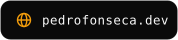

  <picture>
    <source media="(prefers-color-scheme: dark)" srcset="assets/matchday-dark.svg">
    <source media="(prefers-color-scheme: light)" srcset="assets/matchday-light.svg">
    
  </picture>

  

    <a href="https://pedrofonseca.dev"><picture><source media="(prefers-color-scheme: dark)" srcset="assets/btn-site-dark.svg"><source media="(prefers-color-scheme: light)" srcset="assets/btn-site-light.svg"></picture></a>
    <a href="https://www.linkedin.com/in/pedromlfonseca/"><picture><source media="(prefers-color-scheme: dark)" srcset="assets/btn-linkedin-dark.svg"><source media="(prefers-color-scheme: light)" srcset="assets/btn-linkedin-light.svg"></picture></a>
    <a href="mailto:pedro@pedro26.pt"><picture><source media="(prefers-color-scheme: dark)" srcset="assets/btn-mail-dark.svg"><source media="(prefers-color-scheme: light)" srcset="assets/btn-mail-light.svg"></picture></a>
    <a href="https://pedro26.pt"><picture><source media="(prefers-color-scheme: dark)" srcset="assets/btn-art-dark.svg"><source media="(prefers-color-scheme: light)" srcset="assets/btn-art-light.svg"></picture></a>
  

 

I build interfaces people enjoy using, with a designer's eye and a tester's paranoia. Six seasons consulting across news, pro sport, energy, security and e-commerce, from Next.js migrations and Playwright test suites to interactive maps, charts and LLM chat tools.

When I'm not writing code, I'm drawing football or teaching other people how to write code.

 

<picture>
  <source media="(prefers-color-scheme: dark)" srcset="assets/lineup-dark.svg">
  <source media="(prefers-color-scheme: light)" srcset="assets/lineup-light.svg">
  
</picture>

  

  <a href="https://github.com/PMLF/liga-atlantica"><picture><source media="(prefers-color-scheme: dark)" srcset="assets/fixture-liga-dark.svg"><source media="(prefers-color-scheme: light)" srcset="assets/fixture-liga-light.svg"></picture></a>
  <a href="https://pedrofonseca.dev"><picture><source media="(prefers-color-scheme: dark)" srcset="assets/fixture-site-dark.svg"><source media="(prefers-color-scheme: light)" srcset="assets/fixture-site-light.svg"></picture></a>

 

  <a href="https://futurice.com"><picture><source media="(prefers-color-scheme: dark)" srcset="assets/note-club-dark.svg"><source media="(prefers-color-scheme: light)" srcset="assets/note-club-light.svg"></picture></a>
  <picture><source media="(prefers-color-scheme: dark)" srcset="assets/note-coaching-dark.svg"><source media="(prefers-color-scheme: light)" srcset="assets/note-coaching-light.svg"></picture>
  <a href="https://pedro26.pt"><picture><source media="(prefers-color-scheme: dark)" srcset="assets/note-art-dark.svg"><source media="(prefers-color-scheme: light)" srcset="assets/note-art-light.svg"></picture></a>
  <a href="https://caldassportclube.pt/"><picture><source media="(prefers-color-scheme: dark)" srcset="assets/note-home-dark.svg"><source media="(prefers-color-scheme: light)" srcset="assets/note-home-light.svg"></picture></a>

